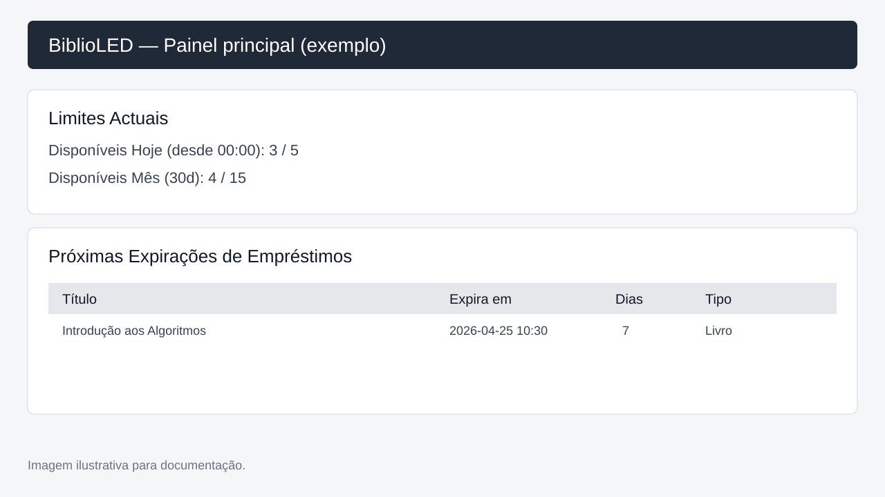
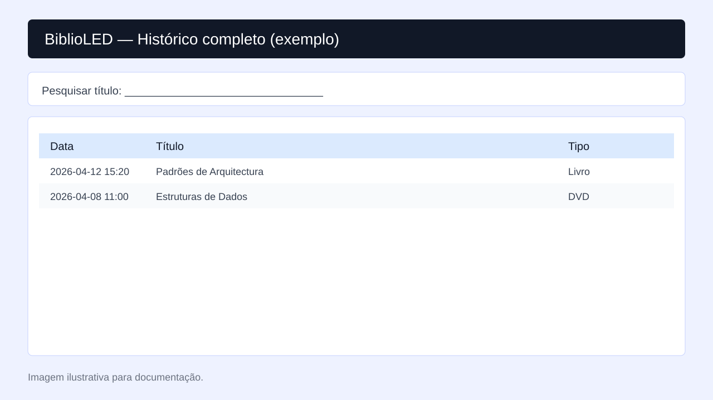

# BiblioLED

Aplicação de ambiente de trabalho para registo e acompanhamento de empréstimos, com foco em simplicidade operacional, controlo de limites e consulta de histórico.

## Visão geral

O BiblioLED permite:

- registar novos empréstimos com data/hora e tipo;
- acompanhar disponibilidade diária e mensal de acordo com limites configuráveis;
- consultar próximas expirações de empréstimos activos;
- pesquisar, editar e eliminar registos históricos;
- exportar dados para CSV;
- visualizar estatísticas avançadas.

A interface gráfica é desenvolvida com `tkinter` e os dados são guardados em SQLite.

## Requisitos

- Python 3.8 ou superior;
- `tkinter` disponível no sistema operativo;
- permissões de escrita na pasta da aplicação (base de dados, exportações e definições).

## Instalação e execução

1. Clone este repositório.
2. Entre na pasta do projecto.
3. Execute a aplicação:

```bash
python biblioled.pyw
```

> Nota: em alguns sistemas pode ser necessário executar com `python3`.

## Capturas de ecrã

### Painel principal



### Janela de histórico



## Configuração

A configuração base encontra-se em `config.py`. Os principais parâmetros incluem:

- ficheiro da base de dados (`DB_FILE`);
- duração dos empréstimos (`LOAN_DURATION_DAYS`);
- janela mensal para contabilização (`MONTHLY_WINDOW_DAYS`);
- limites diários e mensais (`MAX_DAILY_LOANS`, `MAX_MONTHLY_LOANS`);
- formato de datas e delimitador CSV.

As definições de utilizador podem ser persistidas em `user_settings.json`.

## Estrutura principal

- `biblioled.pyw` — ponto de entrada e orquestração da interface.
- `data_utils.py` — operações de base de dados, leitura/escrita e métricas.
- `ui_components.py` — componentes e diálogos da interface.
- `gui_utils.py` — utilitários de suporte para interface.
- `config.py` — constantes e carregamento de definições.

## Dados e exportação

- Base de dados SQLite: `biblioteca.db` (por omissão);
- exportações CSV: pasta `exports/`;
- migração legada: quando aplicável, o histórico CSV pode ser migrado para SQLite.

## Observações

Este projecto foi concebido para utilização local. Recomenda-se cópia de segurança periódica da base de dados e dos ficheiros de configuração.
